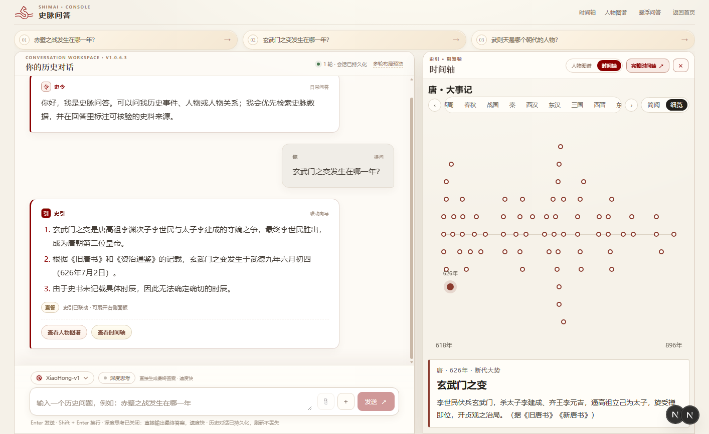
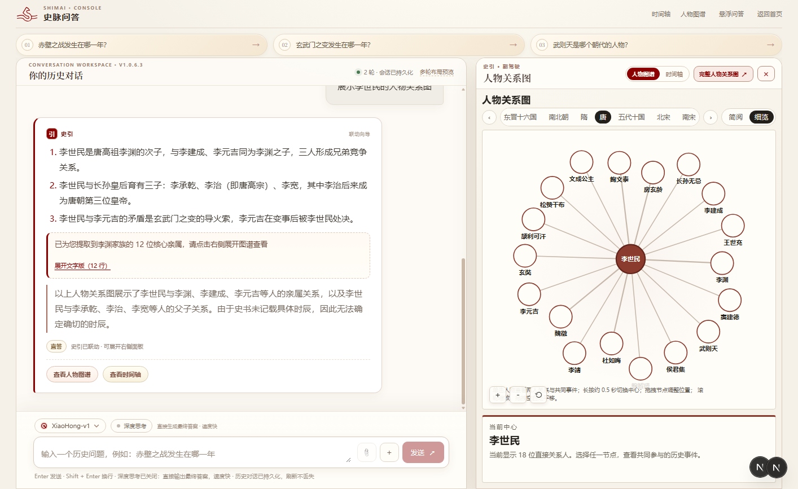

<div align="center">

# 史脉 · HistoLink

中国历史知识图谱与问答应用：全朝代时间轴、人物关系图，以及基于图谱 + RAG 混合检索的问答 Agent。

[](CHANGELOG.md)
[](backend/tests)
[](frontend)
[](backend)
[](LICENSE)
[](#数据来源与许可)

[功能](#功能) · [快速开始](#快速开始) · [技术栈](#技术栈) · [文档](#文档) · [版本规划](#版本规划)

</div>

<p align="center">
  
  
  <br />
  <sub>问答驱动的 UI 联动：一次提问同时命中时间轴与人物关系图，右侧「史引」副驾驶分屏展示对应视图</sub>
</p>

---

## 功能

### 时间轴（`/timeline`）

- 覆盖约公元前 2070 年至 1912 年：862 条精选事件、23 个朝代 / 时期、7 大断代（先秦 / 秦汉 / 三国 / 魏晋南北朝 / 隋唐 / 五代辽宋夏金 / 元明清）。
- 简阅 / 细览双模式：简阅仅保留重要度 3 的 178 条断代大势，细览展示全部事件。
- 事件按年份自动上下错层，密集朝代收缩圆点；朝代 Tab 支持拖拽与惯性滑行。
- 深链接 `/timeline?event=…&dynasty=…&mode=…` 可恢复视图。
- 公元前年份统一由 `frontend/lib/year.ts` 格式化，遵循「不存在公元 0 年」的纪年规则；跨纪元跨度用天文纪年换算。

### 人物关系图（`/graph`）

- D3.js（forceSimulation）+ SVG 力导向图：1,217 位人物、840 对人工裁定关系、5,112 条图谱边。
- 21 期细览图谱 + 7 组简阅图谱，共 28 张图。
- 单击邻居查看两人关系与共同事件；长按约 500ms 换中心；拖拽调整布局；滚轮只滚动页面，缩放通过画布左下角按钮完成。
- 支持本名 / 庙号 / 别名搜索（如「拓跋宏」→ 孝文帝、「清圣祖」→ 康熙帝）。
- 画布按节点包围盒自动 fit，中心人物保持居中；右侧详情面板高度锁定并内部滚动。

### 问答 Agent（`/ask`）

- 史令 / 史引双人格：史令负责检索与作答，史引负责把回答关联到时间轴 / 人物图，驱动右侧副驾驶分屏。
- 9 个只读工具直接读内存快照；90 篇史料语料切成 360 条 chunk 存入 chromadb，供 `search_historical_text` 检索原文。
- 双数据源检索：历史类问题必须同时命中「时间轴·大事记」与「人物关系图」，双源覆盖由服务端校验。
- SSE 流式直答（`start → delta* → done`）；「深度思考」开关默认关闭。
- 服务端 SQLite 会话持久化，自动注入最近 3 轮历史与会话实体状态；支持置顶 / 重命名 / 删除与模型切换。
- 流式直答轮次的 `ui_actions` 随消息持久化，刷新后历史回答底部的「展开图谱 / 时间轴」按钮仍可用。

### 防幻觉

1. `EvidenceValidator`：evidence / citation 必须命中本轮工具的真实返回，伪造引用或跨实体引用强制降级。
2. `FactCheck`：逐项核验正文中的年份 / 人物 / 书名 / 直接引文，不通过则退回重写（≤2 次），仍不通过回退服务端事实实证正文。
3. `insufficient`（资料不足）与 `refusal`（拒答）使用服务端固定文案，降级路径不注入模型自由文本。
4. 28 条 Prompt Injection / 证据安全用例常驻测试套件。

### 本地模型

- 支持任意 OpenAI 兼容端点：本机 Ollama（XiaoHong-v1）或云端 ModelScope（Qwen3.5）。
- 本地模式无需联网与 API Key，问答数据不出本机；`backend/.env` 一处配置即可切换。
- 主模型限流 / 超时 / 网关错误时自动切换备用模型，`trace.model_used` 标明最终模型。

### 工程

| 维度 | 现状 |
|---|---|
| 自动化测试 | 后端 610 条 pytest / 前端 265 条 vitest / 30 条 golden 评测（contract 模式），全部离线可跑 |
| 质量门禁 | `scripts/verify.ps1` 12 步串行门禁（tsc → build → 6 层数据 / 契约 `--check` → pytest → vitest → evals → 契约测试），任一失败即非 0 退出；GitHub Actions 同源复刻 |
| 契约 | 后端 Pydantic 为唯一事实源 → OpenAPI 3.1 / Action / Tool 三份契约 → `openapi-typescript` 生成前端类型；破坏性变更须升 `SCHEMA_VERSION` |
| 确定性数据 | 内容寻址快照（sha256）+ 事件 / 人物 / 计数锁文件，所有生成脚本支持 `--check` 幂等校验 |
| 安全边界 | 只读 API 闸门（问答 / 会话管理 / 点赞为写入口）、工具参数 `extra="forbid"` 与严格类型、日志脱敏（API Key / Bearer / 可选 PII） |

---

## 快速开始

### 1. 环境要求

| 依赖 | 版本要求 | 说明 |
|---|---|---|
| Node.js | ≥ 20.9 | Next.js 16 引擎要求 |
| pnpm | 任意近版 | 前端包管理器 |
| Python | ≥ 3.11 | 后端运行于 `backend/.venv` |
| 操作系统 | Windows 10/11 / macOS / Linux | Windows 有一键启动器；其他系统按「手动启动」操作 |
| 模型（可选） | OpenAI 兼容服务 | 云端 ModelScope，或本机 Ollama（推荐本地 XiaoHong-v1） |

### 2. 一键启动（Windows）

双击 `启动史脉.cmd`，启动器会依次完成：

1. 检查 Python 虚拟环境 / 后端依赖 / Node / pnpm / 前端依赖，缺失时提示安装（首次运行会创建 `backend/.venv` 并安装依赖）。
2. 启动 FastAPI 后端（<http://127.0.0.1:8000>）与 Next.js 前端（<http://localhost:3000>）。
3. 健康检查通过后打开浏览器，并在同一窗口以 `[后端]` / `[前端]` 前缀聚合日志。
4. `Ctrl+C` 或双击 `停止史脉.cmd` 停止服务（只结束本项目占用的 3000 / 8000 端口）。

启动器参数：`-NoBrowser`（不自动打开浏览器）、`-Restart`（端口占用时强制重启）、`-NoPause`（脚本 / CI 调用不等待回车）。

### 3. 手动启动（全平台）

```powershell
# 后端（FastAPI · 端口 8000）
cd backend
python -m venv .venv                                   # 首次
# Windows:  .\.venv\Scripts\Activate.ps1
# macOS/Linux: source .venv/bin/activate
pip install -r requirements.txt                        # 运行依赖
# 不启动服务、先验证模型连通性（可选）
python scripts/spike_llm.py
uvicorn main:app --reload --port 8000

# 前端（Next.js · 端口 3000）── 另开终端
cd frontend
pnpm install       # 首次
pnpm dev
```

打开 <http://localhost:3000>，页面显示「后端已连接」即前后端联通。

### 4. 配置问答模型（`backend/.env`）

```powershell
Copy-Item backend\.env.example backend\.env
```

方案 A · 本地 Ollama（数据不出本机）

```dotenv
MODELSCOPE_API_KEY=ollama
MODELSCOPE_BASE_URL=http://localhost:11434/v1
MODELSCOPE_MODEL=hf.co/mradermacher/XiaoHong-v1-GGUF:Q4_K_M
MODELSCOPE_FALLBACK_MODEL=hf.co/mradermacher/XiaoHong-v1-GGUF:Q4_K_M
LLM_MODEL_DISPLAY_NAME=XiaoHong-v1
LLM_REASONING_EFFORT=none      # 关闭思考解析，否则流式正文为空
LLM_TIMEOUT_SECONDS=120
```

```powershell
ollama serve
ollama pull hf.co/mradermacher/XiaoHong-v1-GGUF:Q4_K_M
# 重启后端后运行完整探针：连通性 + 思考过滤 + 真实流式问答
backend\.venv\Scripts\python.exe backend\scripts\test_ollama_stream.py
```

方案 B · 云端 ModelScope（OpenAI 兼容）

```dotenv
MODELSCOPE_API_KEY=你的 key
MODELSCOPE_BASE_URL=https://api-inference.modelscope.cn/v1
MODELSCOPE_MODEL=Qwen/Qwen3.5-35B-A3B
MODELSCOPE_FALLBACK_MODEL=Qwen/Qwen3.5-8B-Instruct   # 429/502/504/超时自动降级
```

验证模型：`curl http://127.0.0.1:8000/api/agent/ping_llm`（返回回复 / 模型名 / 耗时）。

### 5. 数据入库脚本

仓库已内置完整数据快照，可直接使用；以下脚本用于重建或扩充数据：

```powershell
# ① RAG 史料向量库（首次或更换 embedding provider 时重建；产物 backend/data/chroma_db/ 不入库）
cd backend
.\.venv\Scripts\python.exe scripts\ingest_rag.py            # 90 篇语料 → 360 chunk → chromadb
.\.venv\Scripts\python.exe scripts\ingest_rag.py --dry-run  # 只解析 / 打印统计，不写库
.\.venv\Scripts\python.exe scripts\ingest_rag.py --stats    # 入库后查看各事件 chunk 分布

# ② 图谱扩充数据全自动入库（扫描 docs/史脉_V1.0.5.4_*.md 的事件表 / 关系表）
cd ..
python backend/scripts/ingest_graph_data.py             # 解析 → 去重合并 → 重建 persons/sources/snapshot → 全量校验
python backend/scripts/ingest_graph_data.py --dry-run   # 只打印合并计划
python backend/scripts/ingest_graph_data.py --check     # CI 幂等校验（生成物是否最新）

# ③ 数据与契约校验
node scripts/validate-data.mjs                          # 事件 / 图谱 / 关系 / 别名 / 名人堂 / docs 六层校验
node scripts/export-snapshot.mjs --check                # 快照是否最新
python backend/scripts/export_contracts.py --check      # 契约生成物是否最新（在 backend/ 下执行）
```

> RAG 向量库为构建产物、不入库（`backend/data/chroma_db/` 已在 `.gitignore` 中）；缺失时问答自动退回图谱证据或返回 `insufficient`。

### 6. 质量门禁（发版前必跑）

> 首次运行前安装测试依赖：`pip install -r backend/requirements-dev.txt`（含 pytest / jsonschema / httpx2 / ruff）。

```powershell
# Windows PowerShell 默认禁止未签名脚本，需 Bypass
powershell -NoProfile -ExecutionPolicy Bypass -File scripts/verify.ps1
powershell -NoProfile -ExecutionPolicy Bypass -File scripts/verify.ps1 -SkipBuild   # 快速回归
powershell -NoProfile -ExecutionPolicy Bypass -File scripts/verify.ps1 -Only 11,12  # 只跑指定步骤
```

12 步门禁：`tsc --noEmit` → `next build` → `validate-data` → `build-persons --check` → `extract-sources --check` → `export_contracts --check` → `gen-frontend-types --check` → `export-snapshot --check` → `pytest` → `vitest` → `run-evals --mode contract` → `validate-contract`。

### 7. 常用地址

| 页面 / 接口 | 地址 | 说明 |
|---|---|---|
| 首页 | <http://localhost:3000> | 模块入口 + 后端连通状态 |
| 时间轴 | <http://localhost:3000/timeline> | 全朝代事件时间轴（简阅 / 细览） |
| 人物关系图 | <http://localhost:3000/graph> | D3 力导向图谱（21 期 + 7 组） |
| 智能问答 | <http://localhost:3000/ask> | 史令 / 史引双人格对话工作区 |
| 健康检查 | `GET /api/health` | 返回 `{"ok": true, "version": "1.0.8"}` |
| 问答（非流式） | `POST /api/agent/ask` | 规划 → 工具 → 双重核查 → `AnswerEnvelope` |
| 问答（流式） | `POST /api/agent/chat_stream` | SSE：`start → delta* → done` |
| 会话管理 | `GET/POST /api/sessions` · `GET/PATCH/DELETE /api/sessions/{id}` | 多轮记忆与历史持久化 |
| 模型注册表 | `GET /api/agent/models` | 主 / 备模型选项（无需 Key 即可读取） |
| 点赞计数 | `GET /api/likes` · `POST /api/likes` | 左下角点赞按钮；计数持久化在 `backend/data/likes.json` |
| 数据接口 | `GET /api/meta` · `/api/entities/*` | 快照版本 / counts / 人物 / 事件 / 搜索 |

---

## 技术栈

| 层级 | 技术选型 |
|---|---|
| 前端 | Next.js 16（App Router）· React 19 · TypeScript strict · CSS Modules |
| 可视化 | D3.js（`d3-force` + `d3-selection`）力导向图 + SVG 时间轴轨道 |
| 后端 | FastAPI · Uvicorn · Pydantic v2 · Python 3.11 |
| Agent | 自研规划器 / 执行器 / 证据校验 / 文本级 FactCheck（纯 JSON 协议 + 只读工具集） |
| 检索 | chromadb 0.4.24 · fastembed `bge-small-zh-v1.5`（本地 ONNX CPU）· 90 篇语料 / 360 chunk |
| 模型 | OpenAI 兼容端点：本机 Ollama（XiaoHong-v1）或云端 ModelScope（Qwen3.5） |
| 持久化 | SQLite 会话库（`backend/data/sessions.v1.sqlite`）· 内容寻址 JSON 快照 |
| 契约 | Pydantic → OpenAPI 3.1 / Actions / Tools → `openapi-typescript` 前端类型 |
| 质量 | pytest 610 · vitest 265 · golden evals 30 · `verify.ps1` 12 步门禁 · GitHub Actions |

---

## 数据规模

| 指标 | 数量 |
|---|---|
| 时间轴事件 | 896 条（时间轴 862 + 仅进图谱 34） |
| 人物主数据 | 1,217 人（1,218 个姓名，同名组 2，别名 86） |
| 人物关系 | 840 对人工裁定关系 |
| 朝代 / 断代 | 23 个朝代 / 时期 · 7 大断代 |
| 人物图谱 | 21 期细览 + 7 组简阅（28 张图）· 2,715 个节点位 · 5,112 条边 |
| 结构化引用 | 853 条有据事件 · 1,182 条引用（657 条单书 + 196 条双书）· 411 个标签 |
| RAG 语料 | 90 篇 · 360 条 ≤500 字 chunk |
| 数据快照 | 约 3.47 MB，内容寻址 `v1-961b63160c79` |

---

## 项目结构

```text
histolink/
├─ frontend/                 Next.js 前端（端口 3000）
│  ├─ app/                   首页 / timeline / graph / ask 四个路由
│  ├─ components/            PersonGraph2D（D3 力导向）· ScrollableTabs · ViewModeSwitch · agent/
│  ├─ data/                  时间轴事件、人物关系、人物主数据、引用索引、锁文件
│  ├─ lib/                   ActionBus / 深链接 / Agent 客户端 / 生成契约类型
│  └─ tests/                 vitest 单测（265 条）
├─ backend/                  FastAPI 后端（端口 8000）
│  ├─ agent/                 规划器 · Schema · 工具层 · 证据校验 · 文本事实核查
│  ├─ rag/                   语料切分 · embedding provider 链 · chromadb 存储
│  ├─ contracts/             API / Action / Tool 契约 Pydantic 事实源
│  ├─ routers/               health · meta · entities · agent · sessions
│  ├─ data/                  快照 + 锁 + 会话库（生成物 / 不入库）
│  ├─ scripts/               入库 · 契约导出 · 探针 · 会话清理
│  └─ tests/                 pytest（610 条，含 28 条注入 / 证据安全红队用例）
├─ contracts/                三份冻结契约导出物
├─ scripts/                  verify.ps1 门禁 · 一键启动 · 数据 / 契约生成器 · 评测器
├─ evals/                    30 条 golden 评测用例
├─ docs/                     设计文档 · 数据语料 · 截图（索引见 docs/README.md）
├─ archive/                  历史开发物料归档
├─ SPEC.md                   产品规格（实现基线）
└─ CHANGELOG.md              版本更新日志
```

---

## 文档

| 文档 | 内容 |
|---|---|
| [docs/README.md](docs/README.md) | 文档总索引：设计 / 数据 / 语料 / 归档 |
| [SPEC.md](SPEC.md) | 产品规格与验收标准（V1.0.8 实现基线） |
| [CHANGELOG.md](CHANGELOG.md) | 按版本组织的更新日志 |
| [docs/V1.0.3-Agent-Core设计.md](docs/V1.0.3-Agent-Core设计.md) | Agent Core：数据结构、JSON 协议、工具注册表、证据校验 |
| [docs/V1.0.5-RAG混合检索设计.md](docs/V1.0.5-RAG混合检索设计.md) | RAG 入库管道、embedding 选型、混合检索与冲突标注 |
| [docs/V1.0.6.1-架构升级-解绑生成权与双重事实核查.md](docs/V1.0.6.1-架构升级-解绑生成权与双重事实核查.md) | 正文生成权解绑 + 双重事实核查架构 |
| [docs/V1.0.6.2-本地Ollama流式接入与日志脱敏.md](docs/V1.0.6.2-本地Ollama流式接入与日志脱敏.md) | 本地大模型接入、SSE 流式直答、思考过滤与日志脱敏 |
| [docs/V1.0.5.4-图谱数据自动入库说明.md](docs/V1.0.5.4-图谱数据自动入库说明.md) | 图谱扩充数据全自动入库流程与后续批次 SOP |
| [contracts/README.md](contracts/README.md) | 三份契约的冻结规则与字段清单 |
| [evals/README.md](evals/README.md) | 30 条 golden 评测用例说明 |

---

## 数据来源与许可

- 代码以 [MIT License](LICENSE) 开源。
- 数据主源基于 [史记知识库 shiji-kb](https://github.com/baojie/shiji-kb)（CC BY-NC-SA 4.0）整理，并参考《汉书》《后汉书》《三国志》《晋书》等正史与公有领域资料人工校订；纪年事实参考 [chinese-history](https://github.com/anthonyhann/chinese-history)（CC0 1.0）。
- 数据仅用于非商业的学习、研究与演示；再分发或改编须署名原作者并以相同许可共享。代码许可见 [LICENSE](LICENSE)，数据与第三方内容许可详见 [docs/README.md](docs/README.md) 与各数据表出处。
- 致谢：[d3](https://d3js.org/) 提供力导向布局能力；[fastembed](https://github.com/qdrant/fastembed) / [BAAI/bge-small-zh-v1.5](https://huggingface.co/BAAI/bge-small-zh-v1.5) 提供本地中文向量化；[Ollama](https://ollama.com/) 与 XiaoHong-v1 提供本地推理。

> **已知限制**：桌面优先，移动端保证可浏览；人物关系图为 2D 一度关系视图；时间轴为精选数据而非穷举；内测场景无账号鉴权，请勿公开暴露到公网；RAG 向量库为本地构建产物，需按上文脚本重建。

---

## 版本规划

V1.0 系列已全部完成：从数据基线到可核验的问答，V1.0.7 为开源发版，V1.0.8 为 UI/UX 收尾补丁（修复刷新后联动按钮丢失，新增左下角印章 / 点赞组件与点赞 API）。

| 版本 | 主题 | 状态 |
|---|---|---|
| **V0.1 – V0.4** | 全栈骨架 → 全朝代时间轴 → D3 力导向人物图 | 已完成 |
| **V0.5 – V0.8** | 图谱分期 / 三栏导航 / 简阅·细览 / 全朝代数据厚度对齐 | 已完成 |
| **V0.9** | 内测封装：同源代理、可配置 CORS、局域网 / UUMit 分享 | 已完成 |
| **V1.0.1 – V1.0.3** | 契约冻结 · 8 个只读工具 · Agent Core 与防幻觉底座 | 已完成 |
| **V1.0.4 – V1.0.5** | 动作联动（Agent → UI）· RAG 混合检索 · 自动降级 | 已完成 |
| **V1.0.5.1 – V1.0.5.4** | 对比任务 · 对话工作区 · 双数据源 · 全自动数据入库 | 已完成 |
| **V1.0.6 – V1.0.6.3** | 多轮记忆 · 双重事实核查 · 本地 Ollama 流式 · 双图联动 | 已完成 |
| **V1.0.7** | 开源发版：全量体检、文档重构、版本统一、开源发布准备 | 已完成 |
| **V1.0.8** | UI/UX 收尾补丁 + 最终整合：刷新恢复联动按钮、左下角「史」印章 / 点赞、点赞 API、Prompt 去推诿、Logo 清理 | 当前版本 |

### V1.1（规划中）

V1.0 系列保留 2D 版本以控制开发成本与验证效率；正式发布后启动 V1.1：

- 3D 星图：基于 three.js / react-three-fiber 的三维力导向人物图，按历史时期分层，支持相机过渡动画，替换现有 2D `/graph`。
- 时光机滑块：时间轴底部加入年代滑块，联动事件过滤、图谱高亮与地图视图。
- 配套增强：图谱节点与 `person_id` 统一命名空间、跨期多跳关系裁剪、移动端手势优化。

完整版本记录见 [CHANGELOG.md](CHANGELOG.md)。

---

<div align="center">

**史脉 HistoLink** · v1.0.8

<sub>代码 MIT · 数据 CC BY-NC-SA 4.0 · © 2026 WileDogUnderTheTree</sub>

</div>